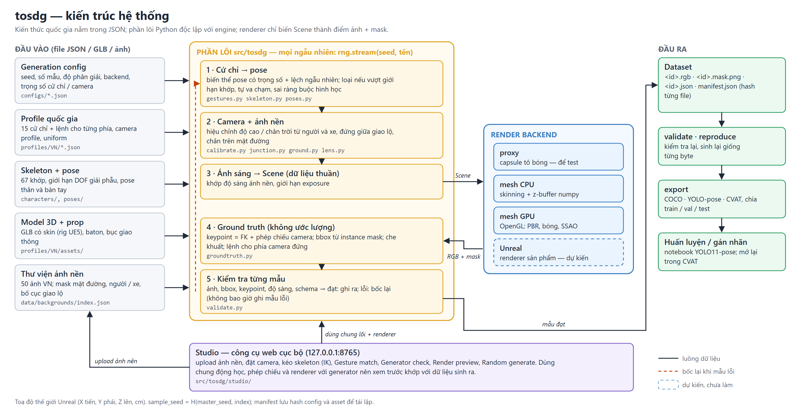

# Traffic Officer Synthetic Data Generator (`tosdg`)

**v4_beta_final** (2026-10-17) · Python ≥ 3.11 · 339 test · hướng dẫn đầy đủ: [`docs/HUONG_DAN.md`](docs/HUONG_DAN.md)

Sinh ảnh tổng hợp **cảnh sát giao thông Việt Nam ra hiệu lệnh** trên ảnh đường phố thật, kèm nhãn chính xác:
bbox, instance mask, 59 keypoint (thân COCO 17 + 2 bàn tay × 21), cử chỉ và **lệnh cho người quan sát** ở vị trí camera.
Nhãn được **tính từ cảnh dựng sẵn** (động học + phép chiếu camera + mask đã render), không bao giờ ước lượng;
mọi mẫu **tái lập giống từng byte** từ seed.



| Phần | Làm gì | Điểm vào |
|---|---|---|
| **Generator** (CLI) | Bốc cử chỉ, pose, camera, ảnh nền, ánh sáng theo seed → render → kiểm tra → ghi ảnh + nhãn; xuất COCO / YOLO-pose / CVAT | `python -m tosdg <lệnh>` |
| **Studio** (web, cục bộ) | Dựng cảnh bằng tay: ảnh nền, camera, kéo skeleton, xem cử chỉ có khớp không, bóng đổ, render thử, sinh lô ngẫu nhiên | `start_studio.bat` / `python -m tosdg studio` |
| **Notebook** | Tinh chỉnh YOLO11-pose trên dữ liệu tosdg và so sánh với YOLO gốc | `notebooks/yolo_finetune_compare.ipynb` |

## Cài đặt

```
git clone https://github.com/levinhhung20032/tosdg.git
cd tosdg
pip install -e .            # numpy, pillow, jsonschema
pip install -e .[gpu]       # tuỳ chọn: renderer GPU (moderngl)
pip install -e .[detect]    # tuỳ chọn: dò mặt đường / người khi nhập ảnh nền (torch, transformers, ultralytics)
pip install -e .[train]     # tuỳ chọn: notebook huấn luyện YOLO
```

Windows: nhấp đúp **`start_studio.bat`**, file này tự cài gói thiếu và mở Studio ở http://127.0.0.1:8765.
Ảnh nền: `data/backgrounds/index.json` liệt kê 50 ảnh đường phố Việt Nam (Wikimedia Commons, nguồn và giấy phép ở
`data/backgrounds/ATTRIBUTION.md`). Ảnh không nằm trong git: tải bằng `fetch_backgrounds.bat`, hoặc dùng ảnh của bạn.

## Bắt đầu nhanh

```
python -m tosdg validate-profile configs/smoke.json             # kiểm tra config + profile
python -m tosdg generate configs/smoke.json --out out/smoke     # sinh lô nhỏ (--overwrite để thay lô cũ)
python -m tosdg validate out/smoke                              # kiểm tra dataset
python -m tosdg reproduce out/smoke                             # sinh lại, so từng byte
python -m tosdg overlay out/smoke --zoom --out overlay.png      # xem nhãn vẽ lên ảnh
python -m tosdg export out/smoke --format yolo --out out/smoke_yolo   # hoặc coco / cvat, chia train/val/test
python -m tosdg studio                                          # công cụ dựng cảnh
```

Lô 300 mẫu với camera hiệu chỉnh từ ảnh nền, đặt người giữa giao lộ, khớp ánh sáng: `configs/dataset_300.json`.
Chưa cài package thì đặt `PYTHONPATH=src` trước các lệnh trên.

## Mỗi mẫu gồm

- `<id>.rgb.png|jpg`: ảnh; `<id>.mask.png`: instance mask của viên cảnh sát;
- `<id>.json`: cử chỉ, pose, góc khớp; bbox; keypoint 2D/3D (kèm trong khung / bị che); camera (K, R, ống kính);
  ảnh nền và cách ghép; ánh sáng và bóng đổ (`lighting.shadow`, khi config bật `shadow`); baton, bục; phía camera đứng và lệnh cho phía đó (`instruction_for_observer`); seed, hash;
- `manifest.json` cho cả lô: config, hash từng file, số lần loại mẫu.

**15 cử chỉ** theo QCVN 41:2019/BGTVT trong `profiles/VN/gestures.json`: tay giơ thẳng đứng, dang ngang, tay phải đưa trước,
dừng phía trước / trái / phải, đi chậm trái / phải, đi nhanh trái / phải, rẽ trái, không ra hiệu; vẫy chào, giơ ngón cái,
tư thế A (weight 0). Bảng đầy đủ: [HUONG_DAN mục 7b](docs/HUONG_DAN.md#7b-danh-sách-hiệu-lệnh-vn-theo-qcvn-412019bgtvt).

## Tài liệu

| File | Nội dung |
|---|---|
| [`docs/HUONG_DAN.md`](docs/HUONG_DAN.md) | Tham chiếu đầy đủ: CLI, Studio, config, định dạng mẫu, quy ước, model 3D, camera |
| [`docs/ARCHITECTURE.md`](docs/ARCHITECTURE.md) | Kiến trúc, mô hình dữ liệu, ground truth, tái lập |
| [`docs/DECISIONS.md`](docs/DECISIONS.md) | Các quyết định thiết kế D1–D45 và lý do |
| [`docs/PROJECT_STATE.md`](docs/PROJECT_STATE.md) | Tiến độ, hạn chế đã biết, việc tiếp theo |
| [`docs/CHANGELOG.md`](docs/CHANGELOG.md) | Lịch sử phiên bản |

## Kiểm thử

```
python -m unittest discover -s tests -t tests     # 339 test, ~2–3 phút; test renderer GPU tự bỏ qua khi máy không có GPU
```

## Hạn chế chính

- Ảnh tổng hợp chưa được đối chiếu với ảnh CSGT thật; một model 3D duy nhất, chưa có xe / người che khuất.
- Ý nghĩa cử chỉ dựng theo tài liệu thứ cấp, **chưa được chuyên gia xác minh** (`verified: false`).
- Model `beta` (Tripo) có mặt người, nguồn gốc / bản quyền chưa rõ: kiểm tra trước khi chia sẻ dataset.
- Backend Unreal (renderer sản phẩm) chưa làm; hiện dùng renderer mesh CPU / GPU tự viết.

Chi tiết: [`docs/PROJECT_STATE.md`](docs/PROJECT_STATE.md).
